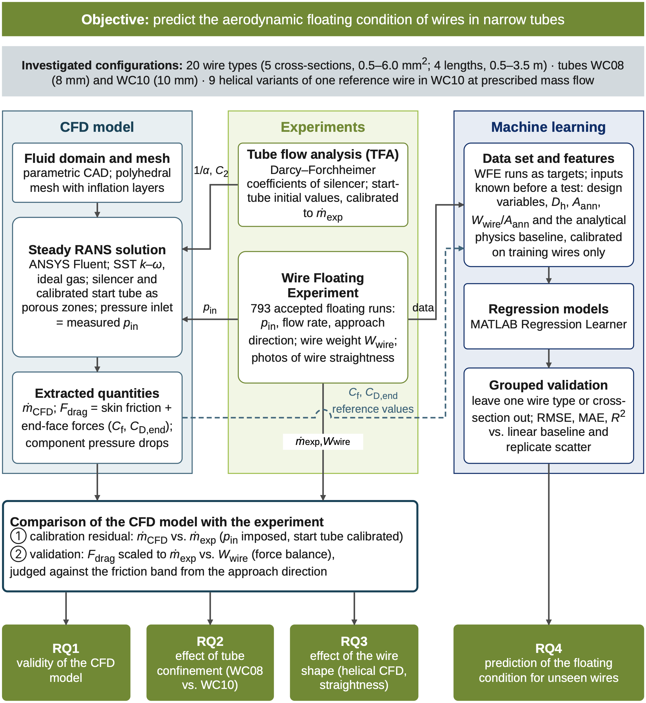
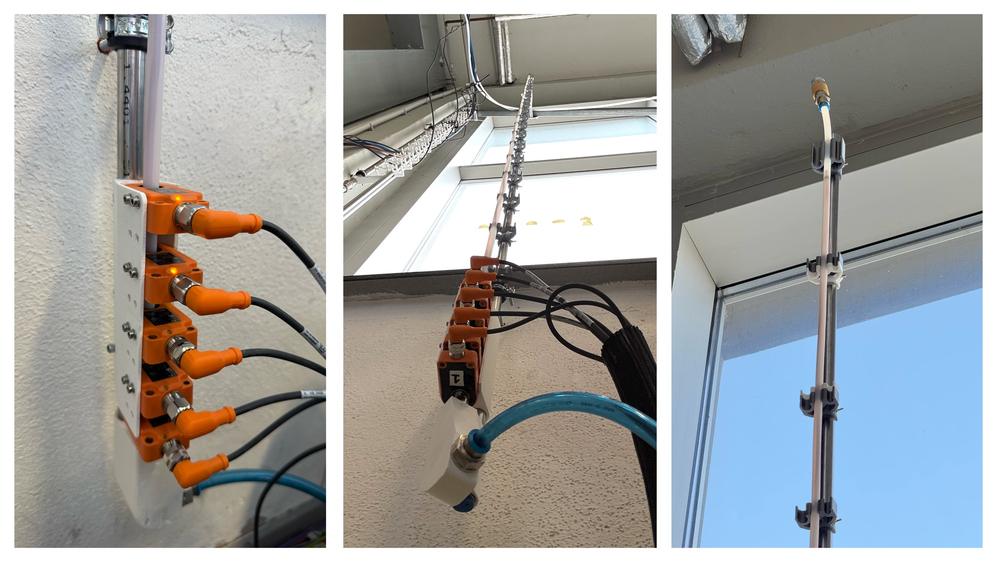

# CFD Modeling and Machine-Learning-Based Prediction of Aerodynamic Floating Conditions in Pneumatic Wire-in-Tube Conveying

Master's thesis data and code — Suavi Yildirim, Institute for Factory Automation and Production Systems (FAPS), Friedrich-Alexander-Universität Erlangen-Nürnberg (FAU), 2026.

## Background

The routing of flexible wires is one of the last largely manual steps in control cabinet manufacturing. Pneumatic transport of wires through tubes is investigated as a contact-free alternative. The air pressure and flow rate at which a wire floats in a vertical tube are the minimum aerodynamic requirement of such a system, but they have so far been found by trial for every wire type.

This work combines three parts:

- **Experiments.** A test series on the Wire Floating Experiment (WFE): 794 stable runs of 20 wire types (5 cross-sections, 0.5–6.0 mm²; 4 lengths, 0.5–3.5 m) in tubes of 8 mm (WC08) and 10 mm (WC10) inner diameter. A Tube Flow Analysis (TFA) characterises the pressure losses of the components in the flow path.
- **CFD.** A steady RANS model (ANSYS Fluent, SST k–ω) of the complete flow path. The silencer and start tube are porous zones calibrated from the TFA. The model includes 9 helical variants of one reference wire.
- **Machine learning.** Physics-informed regression (MATLAB Regression Learner) predicts the floating condition of wire types left out of training.

## Main results

- With the measured inlet pressure imposed, the computed drag force agrees with the wire weight within 20 % for 32 of the 40 configurations after scaling to the measured mass flow rate.
- Skin friction accounts for a median of 61–66 % of the drag. The large pressure forces on the two ferrules largely cancel.
- Moderate helical deformation of the wire changes the drag by less than 2 %.
- For wire types withheld from training, Gaussian process regression predicts flow rate and pressure with mean absolute percentage errors of 7 % and 8 %. That is 1.7 and 1.4 times the repeatability of the experiment. It fails to extrapolate to the largest wire cross-sections.

## Wire Floating Experiment

## Repository contents

| Folder | Contents |
|---|---|
| `03_Experimental_Data/` | WFE run logs `WFE_<UID>_<instance>_<YYYYMMDD>_<HHMM>.csv`, stable-phase summaries (`Stable_Phase_Summary*.csv`), silencer-effect runs (`Schalldampfer Effect/`), TFA runs and processing scripts (`02_TFA_WFE_WTE/`, see `TFA_WFE_Description.txt`) |
| `04_CAD_Geometry/` | Air-volume fluid domains as STEP files for each tube (WC08/WC10) and wire UID, plus the helical variants |
| `05_CFD_Simulation/Report_Data/` | Fluent report files per configuration, the CFD master database and validation scripts |
| `06_Analysis_Scripts/` | Python scripts: data preparation, statistics, WFE/CFD figures, ML figures, photo straightness (see its README) |
| `07_Machine_Learning_PIML/` | MATLAB dataset build, training and grouped validation (`MATLAB_PIML/`), ML datasets (`MAT_Dataset_v8/`), evaluation results, and the Python ablation and figure scripts (`thesis_ml_update/`) |
| `08_Straightness_Analysis/` | Photo-based wire straightness: pipeline code, extracted centrelines and metrics (raw photos not included) |
| `docs/images/` | Figures used in this README |

## Requirements

- Python 3 with `numpy`, `scipy`, `pandas`, `matplotlib` and `openpyxl`
- MATLAB with the Statistics and Machine Learning Toolbox (for `07_Machine_Learning_PIML/MATLAB_PIML`)

Some scripts still contain absolute paths from the author's machine. Adjust them before running.

## Licence

- **Code** (`.py`, `.m`): [MIT License](LICENSE)
- **Data, CAD geometries, figures and documentation**: [CC BY 4.0](LICENSE-DATA.md)

## Citation

If you use this data or code, please cite the thesis. GitHub's "Cite this repository" button gives the reference from [`CITATION.cff`](CITATION.cff):

> Yildirim, S. (2026). *CFD Modeling and Machine-Learning-Based Prediction of Aerodynamic Floating Conditions in Pneumatic Wire-in-Tube Conveying*. Master's thesis, Friedrich-Alexander-Universität Erlangen-Nürnberg (FAU).
